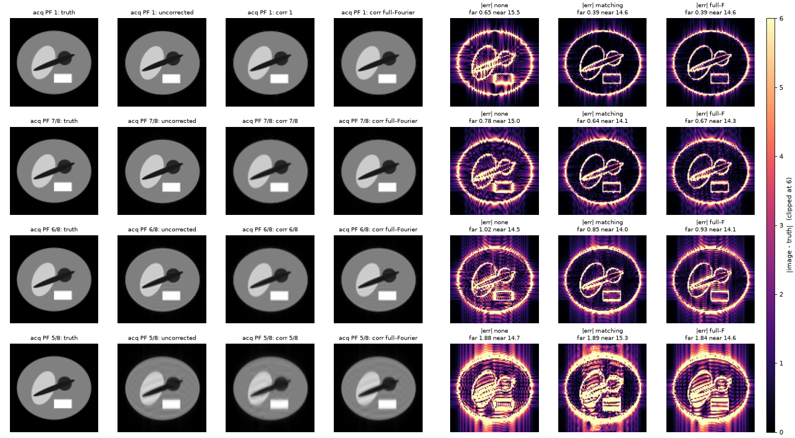
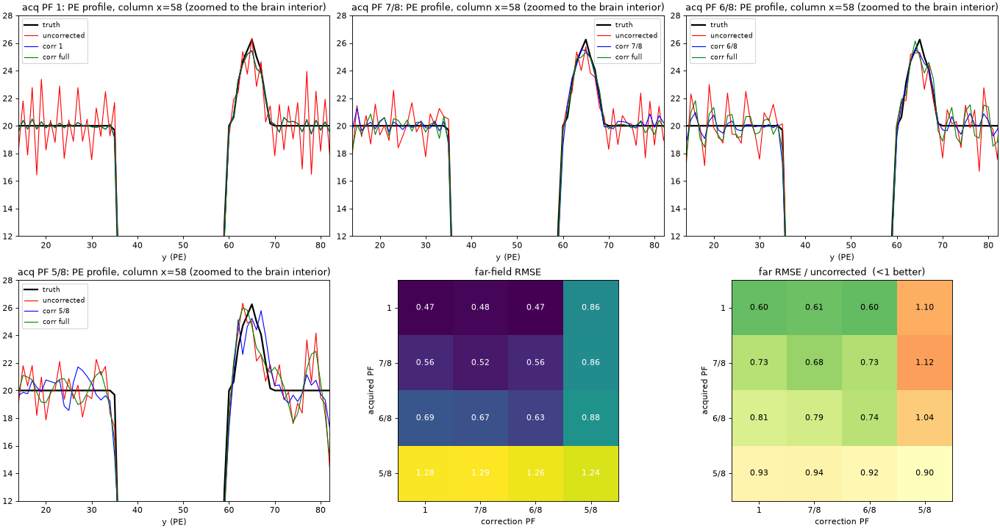

# degibbs.rs

Gibbs-ringing removal for magnitude MRI, in pure Rust.

- **Method:** local subvoxel shifts (Kellner et al., 2016), with the RPG extension for partial-Fourier acquisitions (Lee et al., 2021).
- **Input and output:** NIfTI in, NIfTI out. Works with MRtrix3, FSL, ANTs or any other pipeline.
- **Partial Fourier:** full Fourier, 7/8, 6/8 and 5/8.
- **Binary:** one self-contained executable, no other dependencies.
- **Licence:** non-commercial research only, not for clinical care.

## Contents

- [Quick start](#quick-start)
- [Usage](#usage)
  - [Options](#options)
  - [BIDS sidecar](#bids-sidecar)
  - [MRtrix3 and FSL](#mrtrix3-and-fsl)
- [Choosing the partial-Fourier factor](#choosing-the-partial-fourier-factor)
- [Validation on a Gibbs phantom](#validation-on-a-gibbs-phantom)
  - [Setup](#setup)
  - [Results](#results)
  - [Findings](#findings)
  - [Figures](#figures)
- [Limits](#limits)
- [Licence and citing](#licence-and-citing)

## Quick start

Install (needs Rust 1.85 or newer; this puts `degibbs` on your `PATH`):

```
cargo install --git https://github.com/srikash/degibbs.rs
```

Run it:

```
degibbs in.nii.gz out.nii.gz --pe-axis j --pf 6/8
degibbs dwi.nii.gz dwi_degibbs.nii.gz            # reads dwi.json (BIDS sidecar)
```

## Usage

```
degibbs <input> <output> [options]
```

Input may be 2D, 3D or 4D. Every plane spanned by `--axes` is corrected, and all other axes are looped over. The output is float32 with the input's header and geometry.

### Options

| flag | meaning | default |
|---|---|---|
| `--pe-axis i\|j\|k` (or `0\|1\|2`) | phase-encoding axis in the file's voxel axes (a `+`/`-` sign is accepted and ignored) | from the sidecar; required otherwise |
| `--pf 1\|7/8\|6/8\|5/8` | partial-Fourier factor (decimals such as `0.75` work) | from the sidecar, else `1` |
| `--axes 0,1` | in-plane axis pair containing the PE axis | `0,1`, or from `SliceEncodingDirection` |
| `--json FILE` | BIDS sidecar to read | `<input>.json` next to the input |
| `--no-json` | do not look for a sidecar | off |
| `--nshifts N` | subvoxel shifts per voxel | `20` |
| `--minw N`, `--maxw N` | start and end of the oscillation window | `1`, `3` |
| `--threads N` | worker threads | all cores |

### BIDS sidecar

Keys the tool reads:

| key | sets |
|---|---|
| `PhaseEncodingDirection` (or `PhaseEncodingAxis`) | `--pe-axis` |
| `PartialFourier` | `--pf` |
| `SliceEncodingDirection` | the default `--axes` |

Explicit flags override the sidecar.

> [!WARNING]
> If no partial-Fourier factor is available, the tool assumes full Fourier and says so on stderr. This is the most likely way to get a wrong result. Check that message for partial-Fourier data.

> [!NOTE]
> Sidecar axes describe the NIfTI they were written with. They become stale if the image is reoriented afterwards (for example with `fslreorient2std`), and the tool cannot detect this.

### MRtrix3 and FSL

```
mrconvert dwi.mif dwi.nii.gz -json_export dwi.json -export_grad_fsl dwi.bvec dwi.bval
degibbs dwi.nii.gz dwi_degibbs.nii.gz
mrconvert dwi_degibbs.nii.gz out.mif -fslgrad dwi.bvec dwi.bval
```

## Choosing the partial-Fourier factor

Pass the factor the scan was acquired with. The sidecar's `PartialFourier` sets it automatically.

| acquired | `--pf` | expected result |
|---|---|---|
| full Fourier | `1` | the standard Kellner correction |
| 7/8 | `7/8` | removes more ringing than `1` |
| 6/8 | `6/8` | removes more ringing than `1` |
| 5/8 | `5/8` | little or no benefit; ringing remains and the image blurs |

A mismatched value gives a smaller gain, and `5/8` on any other data makes the result worse. The RPG paper recommends 6/8 over 5/8 when you have a choice at acquisition.

## Validation on a Gibbs phantom

### Setup

- The phantom is a 96 × 96 slice of a high-resolution object (ellipses and a rectangle, with a smooth phase), sampled 8× finer.
- Its k-space is truncated to 96 lines. For partial Fourier, the missing lines on one side of k-space are zeroed.
- The magnitude is then taken, as for zero-filled scanner data.
- The truth is the high-resolution object averaged into voxels.
- Errors are RMSE against that truth, measured more than 4 voxels from any edge, so they show ringing rather than edge blur.

### Results

Far-field RMSE (lower is better; bold marks the best correction in each row):

| acquired | none | `--pf 1` | `--pf 7/8` | `--pf 6/8` | `--pf 5/8` |
|---|---|---|---|---|---|
| full Fourier | 0.649 | **0.392** | 0.405 | **0.392** | 1.228 |
| 7/8 | 0.782 | 0.668 | **0.639** | 0.677 | 1.269 |
| 6/8 | 1.023 | 0.929 | 0.915 | **0.852** | 1.381 |
| 5/8 | 1.878 | 1.835 | 1.841 | **1.826** | 1.891 |

### Findings

- Full-Fourier data improves by about 40%.
- For 7/8 and 6/8 data, the matching setting removes 17–18% of the error and does better than treating the data as full Fourier.
- The `5/8` setting increases the error on every other data set.
- On 5/8 data nothing helps much. The best result is a 3% gain, and the matching `5/8` setting is slightly worse than doing nothing.
- Edge error is 14–15.5 in every case. It comes from the resolution lost to k-space truncation, which no correction recovers.
- Zeroing the other side of k-space gives the same picture.
- With noise at SNR 30 (five seeds), the error floor is about 1.7 and the best setting gains about 10% (5% on 5/8 data). The matching setting is still best for 7/8 and 6/8 data, and `5/8` still hurts the other three.

### Figures



*Left: truth, uncorrected, corrected with the matching factor and corrected as full Fourier. Right: absolute error maps for the same three images, with the far-field and near-edge RMSE in each title.*



*Phase-encode profiles through the phantom, and heatmaps of far-field RMSE, absolute and relative to uncorrected, for every acquired and correction factor.*

This is one phantom. Real data will differ, so read the table for the ordering, not for the size of the gains.

## Limits

- Magnitude (real-valued) images only. Complex images are not supported.
- Supported partial-Fourier factors are 1, 7/8, 6/8 and 5/8.
- Each plane needs lines longer than `maxw + 2` samples, including the sub-lines the partial-Fourier scheme creates.

## Licence and citing

**Licence.** The NYU Non-Commercial Research License, copied unchanged from [NYU-DiffusionMRI/rpg-degibbs](https://github.com/NYU-DiffusionMRI/rpg-degibbs) (see `LICENSE`). Non-commercial research only, not for clinical care, no patent rights granted.

**Required citation.** Clause 6 of the licence requires any publication of research that involves this software to cite:

- Lee, Novikov, Fieremans. Removal of partial Fourier-induced Gibbs (RPG) ringing artifacts in MRI. *Magn Reson Med* 86(5):2733-2750, 2021. [doi:10.1002/mrm.28830](https://doi.org/10.1002/mrm.28830). This is the partial-Fourier method implemented here (`--pf 7/8`, `6/8`, `5/8`).

**Also cite.** Please also cite the method RPG extends. It is the full-Fourier part of this tool (`--pf 1`) and the building block of the partial-Fourier pipelines:

- Kellner, Dhital, Kiselev, Reisert. Gibbs-ringing artifact removal based on local subvoxel-shifts. *Magn Reson Med* 76(5):1574-1581, 2016. [doi:10.1002/mrm.26054](https://doi.org/10.1002/mrm.26054).

Both references are in [`CITATION.bib`](CITATION.bib) for BibTeX and BibLaTeX.
